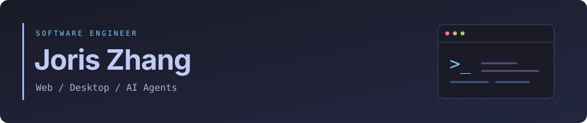

  

  Full-stack engineer at ByteDance · Beijing 
  Building applications and AI agents for software engineering.

  
  

 

<h3 align="center">Languages &amp; Tools</h3>

  

  <samp>AI Agents · Context Engineering · CLI · Skills · Evaluation</samp>

 

<h3 align="center">GitHub Activity</h3>

  
  

  

